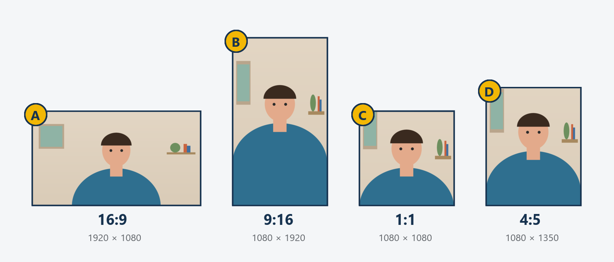
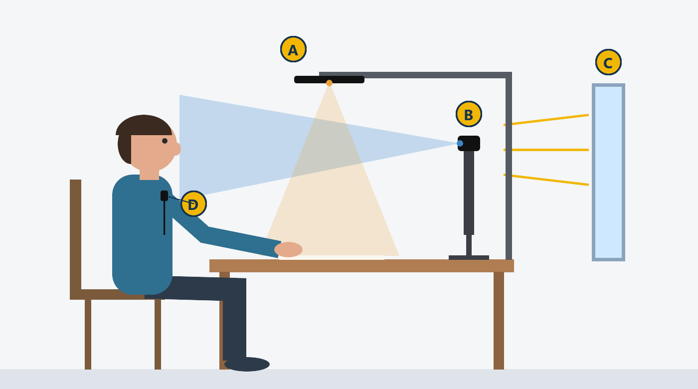
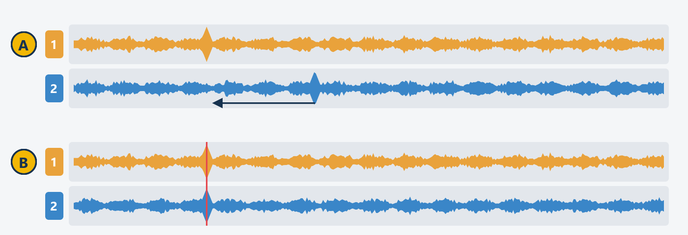
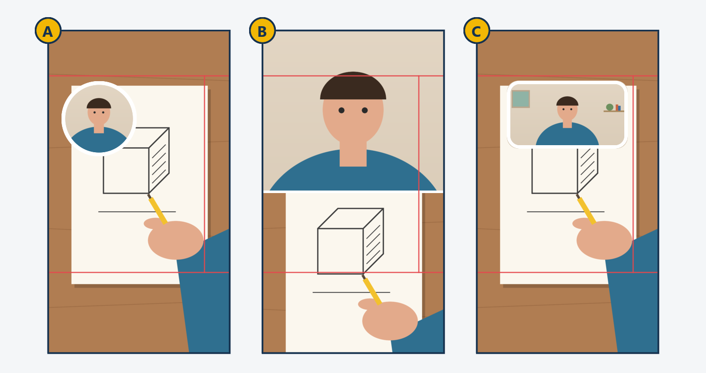
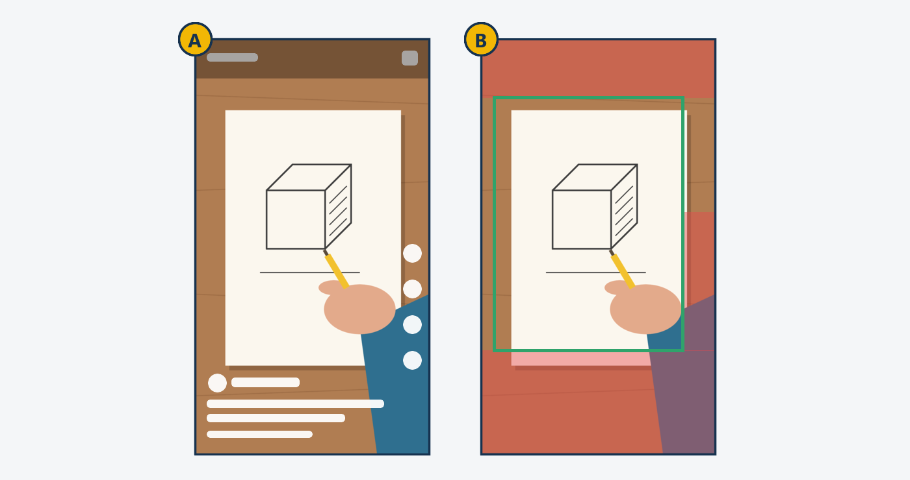
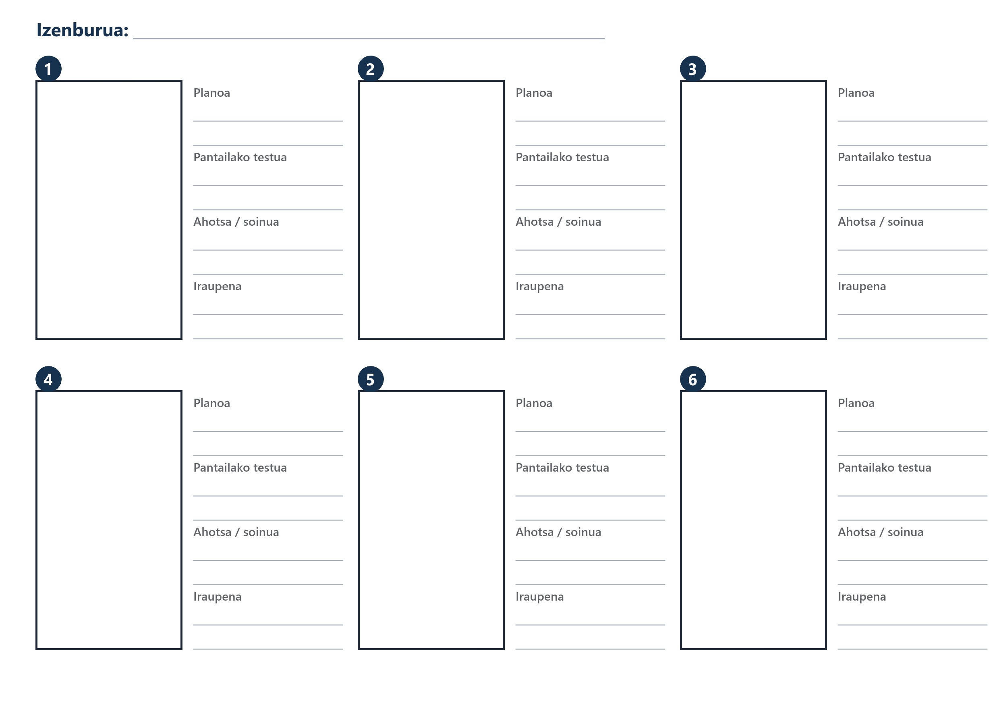

# Grabatu bi kamerarekin: plano frontala eta plano zenitala

"Eskuzko" tutorialak (ekipo bat muntatu, kable bat krinpatu, marraztu, sukaldatu) ia beti bi kamerarekin grabatzen dira: **zenitala**, mahaiari goitik begiratzen diona eta eskuek egiten dutena erakusten duena, eta **frontala**, zu azaltzen erakusten zaituena. Praktika honetan tutorial labur bat planifikatu eta grabatuko duzue bi kamerekin batera, mugikorrean **bertikalean** ikusteko pentsatuta, eta CapCuten egiaztatuko duzue bi planoak bat datozela.

Muntaketa osoa hurrengo praktikan egingo duzue, **material honekin berarekin**; beraz, merezi du kontuz grabatzea.

## Formatuak

*A. 16:9, horizontala (1920 × 1080): YouTube, telebista, aurkezpenak. B. 9:16, bertikala (1080 × 1920): TikTok, Reels, Shorts, istorioak. C. 1:1, karratua (1080 × 1080): argitalpenak. D. 4:5 (1080 × 1350): Instagrameko argitalpenak; karratuak baino pantaila gehiago hartzen du.*

Formatua **grabatu aurretik** erabakitzen da, ez esportatzean: horizontalerako pentsatutako plano batek alboak galtzen ditu bertikalera pasatzean. Erronka hau **9:16** formatuan entregatzen da.

## Platoa

*A. Kamera zenitala: mugikor bat behera begira, mahaiarekiko perpendikular. B. Kamera frontala, begien parean. C. Argi nagusia: leiho bat edo flexo bat, aurrean edo alboan, inoiz ez atzean. D. Mikrofonoa, ahotik gertu.*

- **Kamera zenitala.** Beso batekin, tripode batekin edo etxeko euskarri batekin eutsitako mugikor bat (liburu-pila batetik irteten den ohol bat, mugikorra ondo lotuta). **Geldi** eta mahaiarekiko **perpendikular** egon behar du: okertuta geratzen bada, folioa trapezio baten moduan ikusten da, Photoshopen `Transformar` erabiliz zuzentzen zenuten perspektiba-deformazio bera. Azken bideoa bertikala denez, jarri mugikorra bertikalean. Markatu mahaian zintarekin kamerak ikusten duen eremua, eskuak kanpora atera ez daitezen.
- **Kamera frontala.** OBSrekin grabatutako webcama (aurreko praktikako **Kamera** eszenak balio dizue) edo tripode baten gaineko beste mugikor bat.
- **Bi kamerak, berdin.** Biak **1080p eta 30 fps**-tan (mugikorraren kameraren ezarpenetan aldatzen da). Blokeatu fokua eta esposizioa: ia mugikor guztietan hatza pantailan sakatuta mantenduz egiten da. Hegaldi modua, lente garbia, bateria eta leku librea.
- **Argia.** Lan egiten duzuen eskuaren kontrako aldetik irits dadila, eskuak itzalik egin ez dezan erakusten duzuenaren gainean. Eta ez nahastu leihoko argia fluoreszenteekin, saihestu badaiteke: bakoitzak kolore desberdina du.
- **Soinua.** Erabaki zein gailuk grabatuko duen **audio ona**: ahotik gertuen dagoenak (paparreko mikrofono bat edo mikrodun entzungailu batzuk). Beste kameraren audioa sinkronizatzeko bakarrik erabiliko da.

## Txaloa

*A. Eszena beraren bi grabazio, une desberdinetan hasiak: txaloaren gailurra ez dator bat. B. Pista bat mugitzean bi gailurrak bat etorri arte, irudia eta soinua sinkronizatuta geratzen dira.*

Kamera bakoitza une desberdin batean hasten da grabatzen. Gero lerrokatu ahal izateko, **bi kamerak grabatzen ari direla**, jo **txalo** indartsu bat biek ikusten duten puntu batean. Zineman klaketak egiten duen gauza bera da.

- Ez gelditu kamerarik hartualdia amaitu arte. Bat gelditzen baduzue, beste txalo bat jo behar da.
- Esan ozen hartualdiaren zenbakia ("bigarren hartualdia") txaloaren aurretik: denbora aurreztuko dizue ona bilatzean.

## Konposizio bertikalak

*A. Zenitala pantaila osoan eta kamera frontala zirkulu baten barruan. B. Pantaila zatitua: frontala goian eta zenitala behean. C. Zenitala pantaila osoan eta frontala izkina biribilduak dituen laukizuzen batean. Lerro gorriek eremu seguruak markatzen dituzte.*

Aukeratu bat **grabatu aurretik**, enkoadraketa baldintzatzen duelako:

| Konposizioa | Kamera frontala | Kamera zenitala |
|---|---|---|
| **A** | Aurpegia erdian: zirkulu batean moztuko da. | Mugikorra bertikalean. Utzi libre zirkulua joango den izkina. |
| **B** | Horizontalean: goiko erdia hartuko du. | Ekintzak ia karratua den laukitxo batean sartu behar du. |
| **C** | Horizontalean, plano ertaina. | Mugikorra bertikalean. Utzi libre goiko zerrenda. |

## Eremu seguruak

*A. Aplikazioak zuen bideoaren gainean jartzen duena: goiko barra, eskuineko botoiak eta izena eta deskribapena behean. B. Gorriz, estalita geratzen diren eremuak; berdez, eremu segurua.*

Garrantzitsua den guztiak (aurpegia, eskuak, testuak) eremu berdearen barruan geratu behar du. Erreferentzia gisa, 1080 × 1920ko bideo batean utzi libre **270 px inguru goian**, **480 px behean**, **150 px eskuinean** eta **60 px ezkerrean**.

Materialean `guia-zonas-seguras-1080x1920.png` duzue: eremu horiek markatuta dituen PNG garden bat, konposatzen ari zareten bitartean bideoaren gainean jartzeko.

## Storyboarda

Grabatu aurretik, marraztu bideoa txantiloian (`storyboard-txantiloia.png`). Bineta bat plano bakoitzeko, honekin:

- **Marrazkia**: makilazko panpina bat nahikoa da. Garrantzitsuena zer ikusten den eta zein kameratatik.
- **Planoa**: zenitala, frontala edo biak.
- **Pantailako testua**: une horretan irakurriko dena.
- **Ahotsa / soinua**: esaten dena.
- **Iraupena**: segundotan. Baturak **30 eta 45 segundo** artean eman behar du.

## Egiaztatu planoak CapCuten

Platoa desmuntatu aurretik, egiaztatu ordenagailuan bi grabazioek balio dutela.

1. Pasatu bideoak ordenagailura, proiektuaren karpeta batera, izen argiekin: `frontala_2hartualdia.mp4`, `zenitala_2hartualdia.mp4`.
2. Ireki CapCut, sortu `Nuevo proyecto` bat eta inportatu bi bideoak `Importar` bidez.
3. Erreproduzigailuan, sakatu `Proporción` eta aukeratu `9:16`.
4. Arrastatu plano zenitala pista nagusira eta frontala **gaineko** pista batera.
5. **Sinkronizatu.** Handitu denbora-lerroa (`Ctrl` + saguaren gurpila) uhin-formak ondo ikusi arte. Bilatu txaloaren gailurra bi klipetan eta mugitu goikoa bat etorri arte. Erreproduzitu bi audioak aktibo daudela: oihartzuna entzuten bada, oraindik ez daude lerrokatuta. Lerrokatuta daudenean, isildu audio txarra (klipa hautatuta, `Audio > Volumen` minimora).
6. **Konposatu.** Klip frontala hautatuta, eskuineko panelean:
   - `Vídeo > Básico`: `Escala` eta `Posición`, kokatzeko.
   - `Vídeo > Máscara`: `Círculo` A konposiziorako, edo `Rectángulo` izkinak biribilduta C konposiziorako.
   - B konposiziorako, igo frontala goiko erdira, jaitsi zenitala behekora eta eskalatu bakoitza bere erdia bete arte.
7. Inportatu `guia-zonas-seguras-1080x1920.png`, jarri pistarik altuenean eta luzatu klip osoa iraun dezan. Egiaztatu garrantzitsua den guztia eremu berdearen barruan dagoela.
8. Esportatu **10 edo 15 segundo, gida ikusgai dagoela**: `Exportar`, `Resolución` `1080P`, `Tasa de fotogramas` `30fps` eta `Formato` `MP4` balioekin.

> [!WARNING]
> Ez erabili **Pro** etiketa duen ezer (efektuak, txantiloiak, azpititulu automatikoak...). Denbora-lerroan Pro elementu bakar bat egonda, CapCutek ez du esportatzen uzten ordaindu gabe.

> [!NOTE]
> Menuen izenak pixka bat aldatzen dira CapCuten bertsio batetik bestera. Baten batek ez badu zehazki izen hori, bilatu baliokidea.

> [!TIP]
> Bi kamerak ordenagailu berera konektatuta badaude, OBSrekin ere konposa dezakezue zuzenean: `1080x1920`ko mihisea `Ajustes > Vídeo` atalean, iturri bat kamera bakoitzeko eta materialeko maskarak, aurreko praktikan bezala. Jo txaloa hala ere.

## Zer egin behar da

Taldean, planifikatu eta grabatu **30-45 segundoko eskuzko tutorial bat**. Mahai batean sartu behar du eta denbora horretan azaldu ahal izan behar da. Ideia batzuk: RJ45 konektore bat krinpatu, kable baten hariak T568B arauaren arabera ordenatu, RAM modulu bat edo M.2 SSD bat instalatu, pasta termikoa aplikatu, teklatu bat garbitu, sare txiki baten eskema marraztu...

1. Aukeratu **gaia** eta **konposizioa** (A, B edo C).
2. Bete **storyboarda** sei binetarekin.
3. Muntatu **platoa** eta atera argazki orokor bat, bi kamerak, argia eta mahaia ikusten direla.
4. Grabatu **10 segundoko proba** bat eta berrikusi bi kameretan enkoadraketa, argia eta soinua.
5. Grabatu **tutorial osoa** bi kamerekin batera eta txaloarekin. Errepikatu hartualdi on bat izan arte.
6. Muntatu **plano-proba** CapCuten, eremu seguruen gida ikusgai dagoela.
7. **Gorde material gordina** (jatorrizko grabazioak): hurrengo praktikan behar duzue.

## Entrega

- Storyboarda (argazkia edo PDFa).
- Platoaren argazkia.
- `plano-proba.mp4`: 10-15 segundo, 1080 × 1920, bi kamerak sinkronizatuta aukeratutako konposizioan eta eremu seguruen gida ikusgai.

Material gordina ez da igotzen, baina ez ezabatu.

## Kalifikazioa (0tik 5era)

| Irizpidea | Puntuak |
|---|:---:|
| Storyboard osoa eta errealista: sei bineta, planoarekin, testuarekin, ahotsarekin eta iraupenarekin. | 1 |
| Platoa: zenitala egonkorra eta perpendikularra; argia kontraargirik gabe eta lanaren gainean itzalik gabe. | 1 |
| Grabazioa: bi kamerek ekintza osoa jasotzen dute, foku eta esposizio egonkorrekin. | 1 |
| Sinkronia: txaloa bat dator irudian eta soinuan, eta ez dago oihartzunik. | 1 |
| Konposizio bertikala: garrantzitsua den guztia eremu seguruen barruan geratzen da. | 1 |

## Irudien kredituak

- Eskemak eta txantiloiak praktika hauetarako sortu dira eta erabilera librekoak dira.
