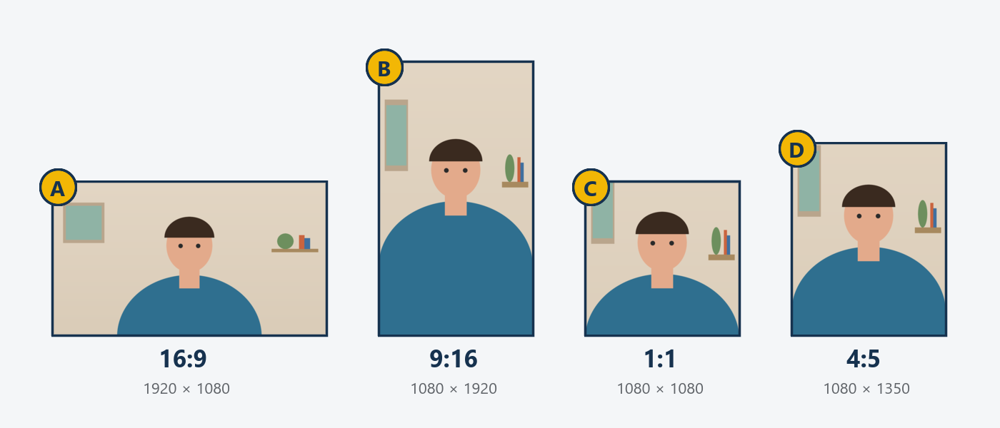
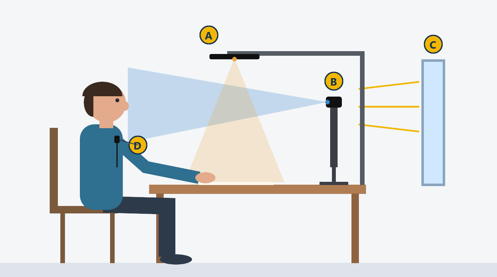
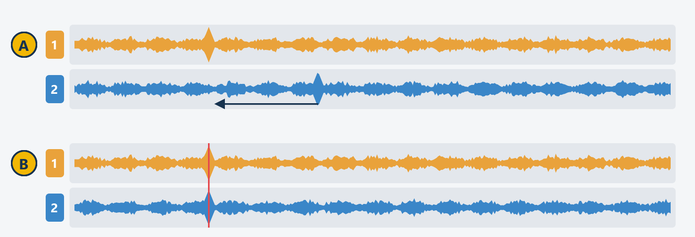
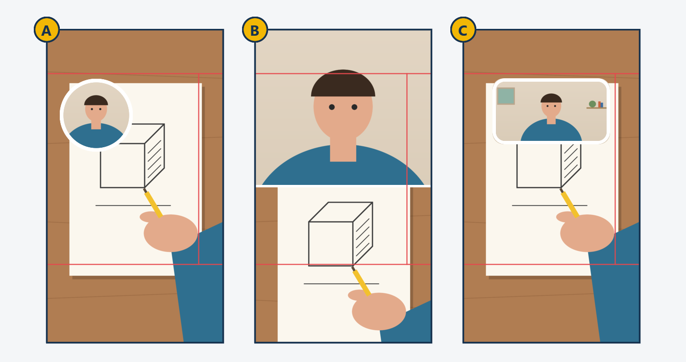
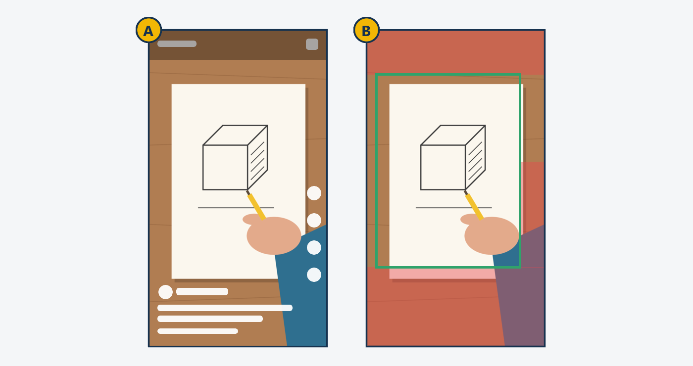
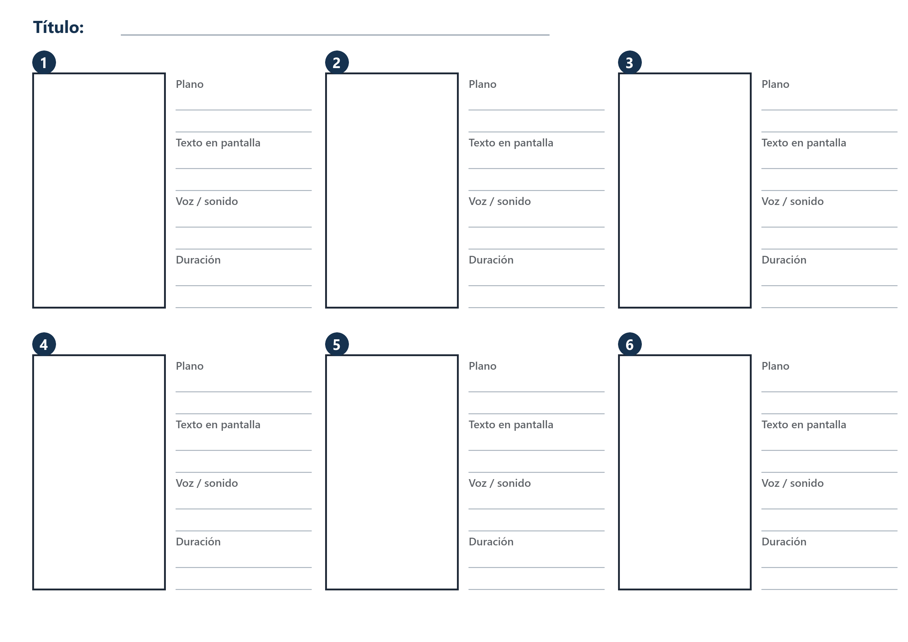

# Graba con dos cámaras: plano frontal y plano cenital

Los tutoriales "de manos" (montar un equipo, crimpar un cable, dibujar, cocinar) se graban casi siempre con dos cámaras: una **cenital**, que mira la mesa desde arriba y enseña lo que hacen las manos, y una **frontal**, que te enseña a ti explicándolo. En esta práctica vais a planificar y grabar un tutorial corto con las dos cámaras a la vez, pensado para verse **en vertical** en un móvil, y vais a comprobar en CapCut que los dos planos encajan.

El montaje completo lo haréis en la práctica siguiente **con este mismo material**, así que merece la pena grabarlo con cuidado.

## Formatos

*A. 16:9, horizontal (1920 × 1080): YouTube, televisión, presentaciones. B. 9:16, vertical (1080 × 1920): TikTok, Reels, Shorts, historias. C. 1:1, cuadrado (1080 × 1080): publicaciones. D. 4:5 (1080 × 1350): publicaciones de Instagram; ocupa más pantalla que el cuadrado.*

El formato se decide **antes de grabar**, no al exportar: un plano pensado para horizontal pierde los lados al pasarlo a vertical. Este reto se entrega en **9:16**.

## El plató

*A. Cámara cenital: un móvil mirando hacia abajo, perpendicular a la mesa. B. Cámara frontal, a la altura de los ojos. C. Luz principal: una ventana o un flexo, delante o de lado, nunca detrás. D. Micrófono, cerca de la boca.*

- **Cámara cenital.** Un móvil sujeto con un brazo, un trípode o un soporte casero (una tabla que sobresalga de una pila de libros, con el móvil bien sujeto). Tiene que estar **quieto** y **perpendicular** a la mesa: si queda inclinado, el folio se ve como un trapecio, la misma deformación de perspectiva que corregías en Photoshop con `Transformar`. Como el vídeo final es vertical, coloca el móvil en vertical. Marca en la mesa con cinta la zona que ve la cámara para que las manos no se salgan.
- **Cámara frontal.** La webcam grabada con OBS (te sirve la escena **Cámara** de la práctica anterior) u otro móvil sobre un trípode.
- **Las dos cámaras, iguales.** Las dos a **1080p y 30 fps** (se cambia en los ajustes de la cámara del móvil). Bloquea el enfoque y la exposición: en casi todos los móviles se hace manteniendo el dedo sobre la pantalla. Modo avión, lente limpia, batería y espacio libre.
- **Luz.** Que llegue desde el lado contrario a la mano con la que trabajas, para que la mano no haga sombra sobre lo que enseñas. Y no mezcles luz de ventana con fluorescentes si puedes evitarlo: cada una tiene un color distinto.
- **Sonido.** Decidid qué aparato graba **el audio bueno**: el que esté más cerca de la boca (un micrófono de solapa o unos auriculares con micro). El audio de la otra cámara solo se usará para sincronizar.

## La palmada

*A. Dos grabaciones de la misma escena que empezaron en momentos distintos: el pico de la palmada no coincide. B. Al mover una pista hasta que los dos picos coinciden, imagen y sonido quedan sincronizados.*

Cada cámara empieza a grabar en un momento distinto. Para poder alinearlas después, con **las dos cámaras ya grabando**, dad **una palmada** fuerte en un punto que vean las dos. Es lo mismo que hace la claqueta en el cine.

- No paréis ninguna cámara hasta terminar la toma. Si paráis una, hay que dar otra palmada.
- Decid en voz alta el número de toma ("toma dos") antes de la palmada: os ahorrará tiempo al buscar la buena.

## Composiciones verticales

*A. Cenital a pantalla completa y cámara frontal dentro de un círculo. B. Pantalla partida: frontal arriba y cenital abajo. C. Cenital a pantalla completa y frontal en un rectángulo con las esquinas redondeadas. Las líneas rojas marcan las zonas seguras.*

Elegid una **antes de grabar**, porque condiciona cómo hay que encuadrar:

| Composición | Cámara frontal | Cámara cenital |
|---|---|---|
| **A** | La cara centrada: se va a recortar en un círculo. | Móvil en vertical. Dejad libre la esquina donde irá el círculo. |
| **B** | En horizontal: ocupará la mitad superior. | La acción tiene que caber en un recuadro casi cuadrado. |
| **C** | En horizontal, plano medio. | Móvil en vertical. Dejad libre la franja superior. |

## Zonas seguras

*A. Lo que la aplicación pone encima de vuestro vídeo: la barra superior, los botones de la derecha y el nombre y la descripción abajo. B. En rojo, las zonas que quedan tapadas; en verde, la zona segura.*

Todo lo importante (la cara, las manos, los textos) tiene que quedar dentro de la zona verde. Como referencia, en un vídeo de 1080 × 1920 dejad libres unos **270 px arriba**, **480 px abajo**, **150 px a la derecha** y **60 px a la izquierda**.

En el material tenéis `guia-zonas-seguras-1080x1920.png`, un PNG transparente con estas zonas marcadas para ponerlo encima del vídeo mientras componéis.

## El storyboard

Antes de grabar, dibujad el vídeo en la plantilla (`plantilla-storyboard.png`, o `storyboard-txantiloia.png` en euskera). Una viñeta por plano, con:

- **Dibujo**: un monigote basta. Lo que importa es qué se ve y desde qué cámara.
- **Plano**: cenital, frontal o los dos.
- **Texto en pantalla**: lo que se leerá en ese momento.
- **Voz / sonido**: lo que se dice.
- **Duración**: en segundos. La suma tiene que dar entre **30 y 45 segundos**.

## Comprobad los planos en CapCut

Antes de desmontar el plató, comprobad en el ordenador que las dos grabaciones sirven.

1. Pasad los vídeos al ordenador, a una carpeta del proyecto, con nombres claros: `frontal_toma2.mp4`, `cenital_toma2.mp4`.
2. Abrid CapCut, cread un `Nuevo proyecto` e importad los dos vídeos con `Importar`.
3. En el reproductor, pulsad `Proporción` y elegid `9:16`.
4. Arrastrad el plano cenital a la pista principal y el frontal a una pista **por encima**.
5. **Sincronizad.** Ampliad la línea de tiempo (`Ctrl` + rueda del ratón) hasta ver bien las formas de onda. Buscad el pico de la palmada en los dos clips y moved el de arriba hasta que coincidan. Reproducid con los dos audios activos: si se oye eco, todavía no están alineados. Cuando lo estén, silenciad el audio malo (con el clip seleccionado, `Audio > Volumen` al mínimo).
6. **Componed.** Con el clip frontal seleccionado, en el panel derecho:
   - `Vídeo > Básico`: `Escala` y `Posición` para colocarlo.
   - `Vídeo > Máscara`: `Círculo` para la composición A, o `Rectángulo` con las esquinas redondeadas para la C.
   - Para la composición B, subid el frontal a la mitad superior, bajad el cenital a la inferior y escalad cada uno hasta llenar su mitad.
7. Importad `guia-zonas-seguras-1080x1920.png`, ponedla en la pista más alta y estiradla para que dure todo el clip. Comprobad que todo lo importante cae dentro de la zona verde.
8. Exportad **10 o 15 segundos con la guía visible**: `Exportar`, con `Resolución` en `1080P`, `Tasa de fotogramas` en `30fps` y `Formato` en `MP4`.

> [!WARNING]
> No uséis nada que lleve la etiqueta **Pro** (efectos, plantillas, subtítulos automáticos...). Con un solo elemento Pro en la línea de tiempo, CapCut no deja exportar sin pagar.

> [!NOTE]
> Los nombres de los menús cambian un poco de una versión de CapCut a otra. Si alguno no se llama exactamente así, buscad el equivalente.

> [!TIP]
> Si las dos cámaras están conectadas al mismo ordenador, también podéis componer en directo con OBS: lienzo de `1080x1920` en `Ajustes > Vídeo`, una fuente por cámara y las máscaras del material, como en la práctica anterior. Dad la palmada igualmente.

## Qué hay que hacer

En grupo, planificad y grabad un **tutorial manual de 30 a 45 segundos**. Tiene que caber en una mesa y poder explicarse en ese tiempo. Algunas ideas: crimpar un conector RJ45, ordenar los hilos de un cable según la norma T568B, instalar un módulo de RAM o un SSD M.2, aplicar pasta térmica, limpiar un teclado, dibujar el esquema de una red pequeña...

1. Elegid el **tema** y la **composición** (A, B o C).
2. Rellenad el **storyboard** con seis viñetas.
3. Montad el **plató** y hacedle una foto general en la que se vean las dos cámaras, la luz y la mesa.
4. Grabad una **prueba de 10 segundos** y revisad en las dos cámaras el encuadre, la luz y el sonido.
5. Grabad el **tutorial completo** con las dos cámaras a la vez y con palmada. Repetid hasta tener una toma buena.
6. Montad la **prueba de plano** en CapCut, con la guía de zonas seguras visible.
7. **Guardad los brutos** (las grabaciones originales): los necesitáis en la práctica siguiente.

## Entrega

- El storyboard (foto o PDF).
- La foto del plató.
- `prueba-de-plano.mp4`: de 10 a 15 segundos, a 1080 × 1920, con las dos cámaras sincronizadas en la composición elegida y la guía de zonas seguras visible.

Los brutos no se suben, pero no los borréis.

## Calificación (0 a 5)

| Criterio | Puntos |
|---|:---:|
| Storyboard completo y realista: seis viñetas con plano, texto, voz y duración. | 1 |
| Plató: cenital estable y perpendicular; luz sin contraluz y sin sombras sobre el trabajo. | 1 |
| Grabación: las dos cámaras recogen la acción completa, con enfoque y exposición estables. | 1 |
| Sincronía: la palmada coincide en imagen y sonido, y no hay eco. | 1 |
| Composición vertical: todo lo importante queda dentro de las zonas seguras. | 1 |

## Créditos de las imágenes

- Los esquemas y las plantillas se han generado para estas prácticas y son de uso libre.
