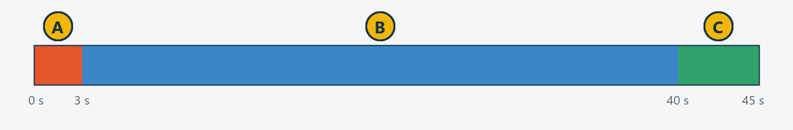
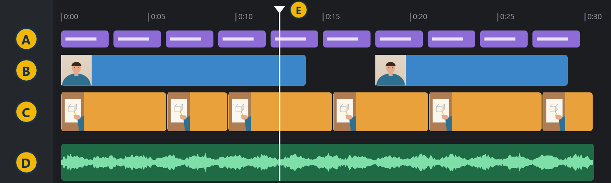
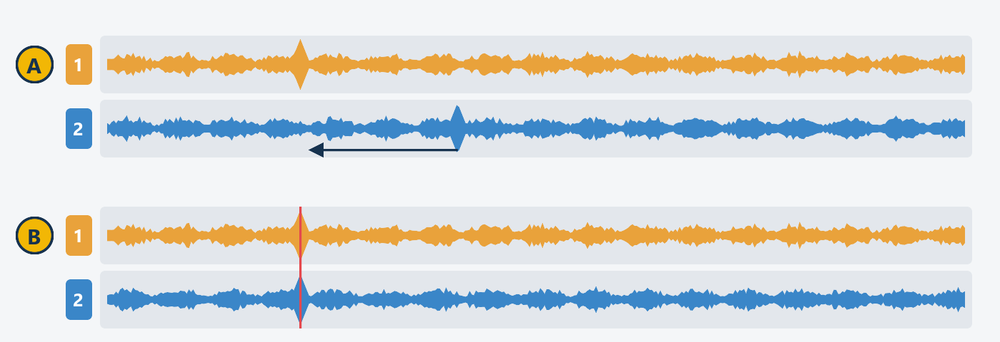
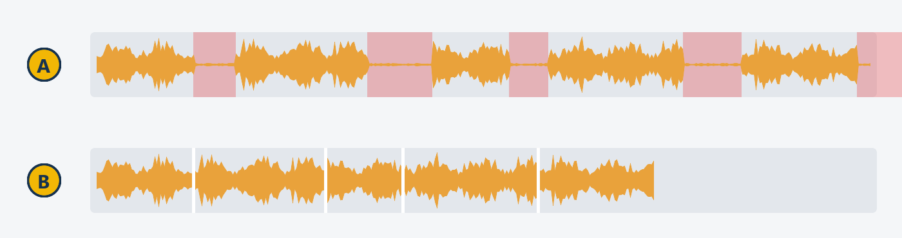

# Muntaketa CapCuten: erritmoa, testuak eta soinua

Tutoriala bi kamerarekin grabatuta daukazue. Muntatzea **segundo bakoitzean zer ikusten den eta zer entzuten den** erabakitzea da, eta bideo labur batean segundo bakoitzak balio du: ikusten duenak lehen hiru segundoetan erabakitzen du geratu ala hurrengora pasatu. Praktika honetan aurreko praktikako material gordina 30-45 segundoko bideo bertikal bihurtuko duzue, denbora hilik gabea eta soinurik gabe ere ulertzeko modukoa.

> [!NOTE]
> Menuen izenak pixka bat aldatzen dira CapCuten bertsio batetik bestera. Baten batek ez badu zehazki izen hori, bilatu baliokidea.

## Bideo labur baten egitura

*A. Amua: lehen 3 segundoak. B. Garapena: urratsak. C. Itxiera: azken 5 segundoak.*

- **Amua.** Erakutsi azken emaitza edo planteatu arazoa: "Zure sare-kableak ez du funtzionatzen? Egin bat 40 segundotan". "Kaixo, gu halako gara eta gaur..." bezalakorik ez.
- **Garapena.** Urratsak, ordenan. Ideia bat plano bakoitzeko eta testu bat urrats bakoitzeko.
- **Itxiera.** Emaitza funtzionatzen eta azken esaldi bat.

## Denbora-lerroa

*A. Testuak. B. Kamera frontala: behar denean bakarrik agertzen da. C. Kamera zenitala: pista nagusia, urratsetan moztuta. D. Audioa: ahotsa eta, azpitik, musika. E. Erreprodukzio-burua: erreproduzigailuan ikusten den unea markatzen du.*

Pistek geruzek bezala funtzionatzen dute: goiko pista batean dagoenak azpian dagoena estaltzen du.

| Ekintza | Lasterbidea |
|---|---|
| Erreproduzitu eta pausatu | `Espacio` |
| Klipa zatitu erreprodukzio-buruan | `Ctrl+B` |
| Hautatutakoa ezabatu | `Supr` |
| Desegin | `Ctrl+Z` |
| Denbora-lerroa handitu edo txikitu | `Ctrl` + saguaren gurpila |
| Esportatu | `Ctrl+E` |

## 1. Sinkronizatu eta taldekatu

1. Sortu proiektu berri bat `9:16` formatuan, inportatu bi grabazio gordinak eta sinkronizatu txaloarekin, aurreko praktikan bezala.
2. Isildu audio txarra eta utzi ona bakarrik.
3. Kokatu bi kamerak aukeratu zenuten konposizioan (A, B edo C).
4. Hautatu bi klipak (klik batean eta `Ctrl` + klik bestean), eskuineko botoia eta `Crear clip compuesto`.

Hemendik aurrera bi kamerak **klip bakarra** dira eta ezin dira desinkronizatu, nahi adina moztuta ere. Geroago bereizi behar badituzue, eskuineko botoia eta `Deshacer clip compuesto`.

Zuen bertsioak klip konposaturik ez badu, lan egin beti bi klipak batera hautatuta: zatitu eta ezabatu zati bera bi pistetan, eta egiaztatu sinkronia mozketa bakoitzaren ondoren.

## 2. Kendu isiluneak

*A. Uhin-formak isiluneak salatzen ditu: zati lauak dira, arrosaz markatuta. B. Ahots bera isiluneak moztu ondoren: gutxiago irauten du eta ez da ezer galdu.*

1. Handitu denbora-lerroa uhin-forma ondo ikusi arte.
2. Jarri erreprodukzio-burua isilune bat hasten den lekuan eta sakatu `Ctrl+B`. Egin gauza bera amaitzen den lekuan.
3. Hautatu soberan dagoen zatia eta sakatu `Supr`. Bideoaren gainerakoa bere kabuz elkartzen da.

- Moztu berdin akatsak, errepikatutako esaldiak eta "eeeh"-ak. Normalena grabatutakoaren % 20 eta % 40 artean kentzea da.
- Utzi gutxieneko arnasaldi bat esaldien artean: hitzari itsatsita mozten baduzue, ahotsak presaka dirudi.
- Eskuzko urrats bat luzea eta aspergarria bada (zortzi hari zuritu, torlojuak estutu), ez moztu: azkartu. Klipa hautatuta, `Velocidad` `2x` edo `4x` baliora.
- Mozketa bakoitzak jauzi txiki bat sortzen du irudian. Plano zenitalean ia ez da nabaritzen; pantaila osoko plano frontal batean, bai.

## 3. Ordenatu planoak

- **Hasi amaieratik.** Zatitu azken segundoak, emaitza amaituta ikusten den lekuan, kopiatu (`Ctrl+C`, `Ctrl+V`) eta arrastatu kopia pista nagusiaren hasierara: hori da zuen amua.
- Amuaren ondoren, urratsak egiten diren ordenan. Urratsen bat bi aldiz grabatu bazenuten, geratu onenarekin.
- Mantendu konposizio bera garapen osoan. Bideoaren erdian konposizioz aldatzeak arreta galarazten du.

## 4. Testuak

1. Ireki `Texto`, arrastatu `Texto predeterminado` denbora-lerrora eta idatzi.
2. Doitu haren iraupena laguntzen duen urratsarenera.
3. Eman estiloa eskuineko panelean eta, gustatzen zaizuenean, bikoiztu (`Ctrl+C`, `Ctrl+V`) gainerako urratsetarako: horrela guztiak berdin geratzen dira.

- **Testu bat urrats bakoitzeko**, 2-5 hitzekoa eta zenbakituta: "1. Zuritu 3 cm", "2. Ordenatu hariak".
- **Mugikor batean irakurtzeko modukoa**: letra handia eta kontrastearekin. Zuriak `Trazo` beltzarekin edo `Fondo` batekin edozein irudiren gainean funtzionatzen du.
- **Tipografia bakarra eta bi kolore gehienez**, beti pantailaren leku berean.
- **Eremu seguruaren barruan.** Jarri materialeko gida goiko pistan testuak kokatzen dituzuen bitartean.
- **Irakurtzeko denbora**: bi aldiz irakurtzeko astia eman dezala.

Jende askok bideo hauek **soinurik gabe** ikusten ditu. Urratsen testuen eta azpitituluen artean, esaten duzuen garrantzitsu guztiak idatzita egon behar du. CapCutek `Subtítulos automáticos` aukera du, baina doako bertsioan **Pro** etiketa izan ohi du. Hala bada, idatzi eskuz: 45 segundotan 80 bat hitz sartzen dira. Lerro laburrak, 4-6 hitzekoak, esaten diren unean ager daitezela.

## 5. Soinua

- **Ahotsa.** Entzun bideo osoa entzungailuekin. Klipa hautatuta, `Audio > Volumen` igotzeko edo jaisteko. Ez du inoiz saturatu behar.
- **Musika.** Aukerakoa da. Jartzen baduzue, **ahotsaren oso azpitik**: hasi `-20 dB` inguruan eta doitu belarriz. Esaten duzuena ulertzeko ahalegina egin behar bada, altuegi dago. Jarri segundo erdiko `Fundido de entrada` eta `Fundido de salida`.
- **Eskubideak.** Ez du edozein abestik balio. Erabili lizentzia libreko musika (YouTubeko Audio liburutegia, Pixabay Music, Free Music Archive) eta apuntatu izenburua, egilea eta lizentzia.

## 6. Esportatu

1. **Kendu** eremu seguruen **gida** denbora-lerrotik.
2. Egiaztatu ez dela **Pro** etiketadun elementurik geratzen.
3. `Exportar`: `Resolución` `1080P`, `Tasa de fotogramas` `30fps`, `Códec` `H.264` eta `Formato` `MP4`.
4. Pasatu fitxategia mugikor batera eta ikusi osorik bi aldiz: behin soinurik gabe eta behin soinuarekin.

## Zer egin behar da

Muntatu aurreko praktikan grabatu zenuten tutoriala:

- Bertikala, **1080 × 1920**, **30-45 segundokoa**.
- **Amua, garapena eta itxiera** dituena.
- **Isilunerik**, akatsik eta denbora hilik **gabea**.
- **Bi kamerak** aukeratutako konposizioan konbinatuta.
- **Testu bat urrats bakoitzeko**, eta soinurik gabe ulertzeko modukoa.
- **Ahots argiarekin**. Musika aukerakoa, azpitik eta lizentziarekin.

## Entrega

- `tutoriala.mp4`.
- CapCuten pantaila-argazki bat, denbora-lerro osoarekin.
- Musikaren eta zuena ez den edozein baliabideren kredituak (izenburua, egilea, lizentzia eta esteka), entregaren iruzkinean.

## Kalifikazioa (0tik 5era)

| Irizpidea | Puntuak |
|---|:---:|
| Egitura: amua lehen hiru segundoetan, urrats argiak eta itxiera. | 1 |
| Erritmoa: isilunerik, akatsik eta denbora hilik gabe; 30-45 segundo irauten du. | 1 |
| Irudia: bi kamerek sinkronizatuta jarraitzen dute eta dena eremu seguruen barruan geratzen da. | 1 |
| Testuak: irakurgarriak, akatsik gabeak, testu bat urrats bakoitzeko; bideoa soinurik gabe ulertzen da. | 1 |
| Soinua eta esportazioa: ahots argia, musika azpitik, `.mp4` 1080 × 1920. | 1 |

## Irudien kredituak

- Eskemak praktika hauetarako sortu dira eta erabilera librekoak dira.
