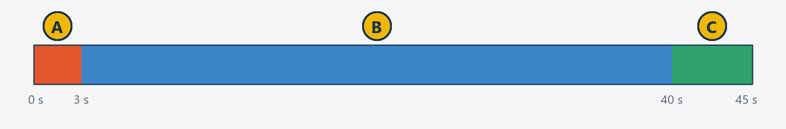
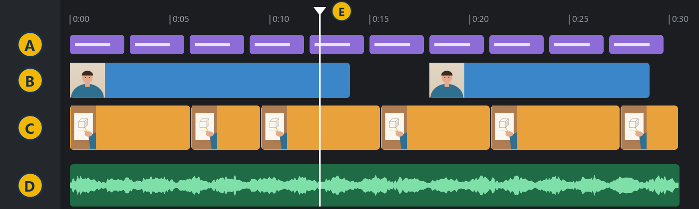
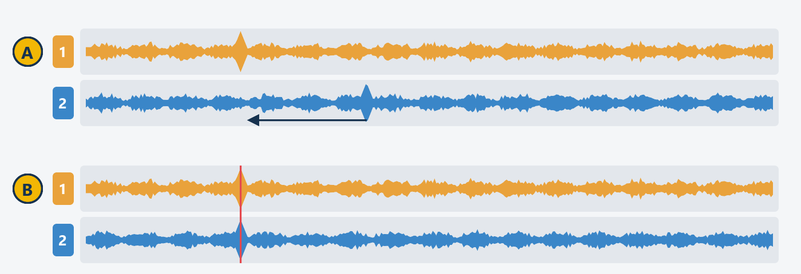
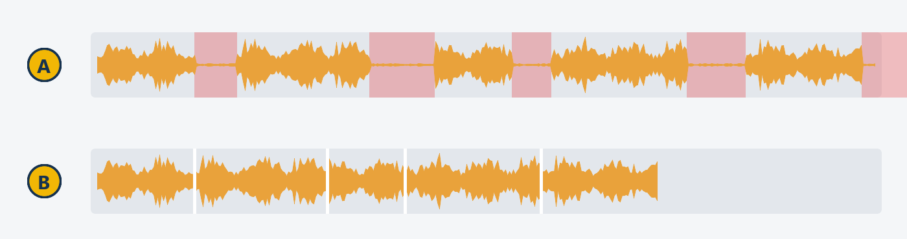

# Montaje en CapCut: ritmo, textos y sonido

Ya tenéis el tutorial grabado con dos cámaras. Montar es decidir **qué se ve y qué se oye en cada segundo**, y en un vídeo corto cada segundo cuenta: quien lo ve decide en los tres primeros si se queda o pasa al siguiente. En esta práctica vais a convertir los brutos de la práctica anterior en un vídeo vertical de 30 a 45 segundos, sin tiempos muertos, que se entienda incluso sin sonido.

> [!NOTE]
> Los nombres de los menús cambian un poco de una versión de CapCut a otra. Si alguno no se llama exactamente así, buscad el equivalente.

## La estructura de un vídeo corto

*A. Gancho: los 3 primeros segundos. B. Desarrollo: los pasos. C. Cierre: los últimos 5 segundos.*

- **Gancho.** Enseñad el resultado final o plantead el problema: "¿Tu cable de red no funciona? Hazte uno en 40 segundos". Nada de "hola, somos tal y hoy vamos a...".
- **Desarrollo.** Los pasos, en orden. Una idea por plano y un texto por paso.
- **Cierre.** El resultado funcionando y una frase final.

## La línea de tiempo

*A. Textos. B. Cámara frontal: solo aparece cuando hace falta. C. Cámara cenital: la pista principal, cortada en pasos. D. Audio: la voz y, por debajo, la música. E. Cabezal de reproducción: marca el instante que se ve en el reproductor.*

Las pistas funcionan como las capas: lo que está en una pista de arriba tapa lo que hay debajo.

| Acción | Atajo |
|---|---|
| Reproducir y pausar | `Espacio` |
| Dividir el clip por el cabezal | `Ctrl+B` |
| Borrar lo seleccionado | `Supr` |
| Deshacer | `Ctrl+Z` |
| Ampliar o reducir la línea de tiempo | `Ctrl` + rueda del ratón |
| Exportar | `Ctrl+E` |

## 1. Sincroniza y agrupa

1. Cread un proyecto nuevo en `9:16`, importad los dos brutos y sincronizadlos con la palmada, como en la práctica anterior.
2. Silenciad el audio malo y dejad solo el bueno.
3. Colocad las dos cámaras en la composición que elegisteis (A, B o C).
4. Seleccionad los dos clips (clic en uno y `Ctrl` + clic en el otro), botón derecho y `Crear clip compuesto`.

A partir de aquí las dos cámaras son **un solo clip** y ya no pueden desincronizarse por mucho que cortéis. Si más adelante necesitáis separarlas, botón derecho y `Deshacer clip compuesto`.

Si vuestra versión no tiene clips compuestos, trabajad siempre con los dos clips seleccionados a la vez: dividid y borrad el mismo trozo en las dos pistas, y comprobad la sincronía después de cada corte.

## 2. Quita los silencios

*A. La forma de onda delata los silencios: son los tramos planos, marcados en rosa. B. La misma voz después de cortarlos: dura menos y no se ha perdido nada.*

1. Ampliad la línea de tiempo hasta ver bien la forma de onda.
2. Colocad el cabezal donde empieza un silencio y pulsad `Ctrl+B`. Haced lo mismo donde termina.
3. Seleccionad el trozo que sobra y pulsad `Supr`. El resto del vídeo se junta solo.

- Cortad igual los errores, las frases repetidas y los "eeeh". Lo normal es quitar entre un 20 y un 40 % de lo grabado.
- Dejad un respiro mínimo entre frases: si cortáis pegado a la palabra, la voz suena atropellada.
- Si un paso manual es largo y aburrido (pelar ocho hilos, atornillar), no lo cortéis: aceleradlo. Con el clip seleccionado, `Velocidad` a `2x` o `4x`.
- Cada corte produce un pequeño salto en la imagen. En el plano cenital apenas se nota; en un plano frontal a pantalla completa, sí.

## 3. Ordena los planos

- **Empezad por el final.** Dividid los últimos segundos, donde se ve el resultado terminado, copiadlos (`Ctrl+C`, `Ctrl+V`) y arrastrad la copia al principio de la pista principal: ese es vuestro gancho.
- Después del gancho, los pasos en el orden en que se hacen. Si grabasteis algún paso dos veces, quedaos con la mejor.
- Mantened la misma composición durante todo el desarrollo. Cambiar de composición a mitad de vídeo distrae.

## 4. Textos

1. Abrid `Texto`, arrastrad `Texto predeterminado` a la línea de tiempo y escribid.
2. Ajustad su duración a la del paso que acompaña.
3. Dadle estilo en el panel derecho y, cuando os guste, duplicadlo (`Ctrl+C`, `Ctrl+V`) para el resto de pasos: así todos quedan iguales.

- **Un texto por paso**, de 2 a 5 palabras y numerado: "1. Pela 3 cm", "2. Ordena los hilos".
- **Que se lea en un móvil**: letra grande y con contraste. Blanco con `Trazo` negro o con `Fondo` funciona sobre cualquier imagen.
- **Una sola tipografía y dos colores como mucho**, siempre en el mismo sitio de la pantalla.
- **Dentro de la zona segura.** Poned la guía del material en la pista de arriba mientras colocáis los textos.
- **Tiempo de lectura**: que dé tiempo a leerlo dos veces.

Mucha gente ve estos vídeos **sin sonido**. Entre los textos de los pasos y los subtítulos, todo lo importante que decís tiene que estar escrito. CapCut tiene `Subtítulos automáticos`, pero en la versión gratuita suele llevar la etiqueta **Pro**. Si es vuestro caso, escribidlos a mano: en 45 segundos caben unas 100 palabras. Líneas cortas, de 4 a 6 palabras, que aparezcan cuando se dicen.

## 5. Sonido

- **Voz.** Escuchad el vídeo entero con auriculares. Con el clip seleccionado, `Audio > Volumen` para subirla o bajarla. No tiene que saturar en ningún momento.
- **Música.** Es opcional. Si la ponéis, **muy por debajo de la voz**: empezad en unos `-20 dB` y ajustad de oído. Si hay que esforzarse para entender lo que decís, está alta. Poned un `Fundido de entrada` y un `Fundido de salida` de medio segundo.
- **Derechos.** No vale cualquier canción. Usad música con licencia libre (Biblioteca de audio de YouTube, Pixabay Music, Free Music Archive) y apuntad el título, el autor y la licencia.

## 6. Exporta

1. **Quitad la guía** de zonas seguras de la línea de tiempo.
2. Comprobad que no queda ningún elemento con la etiqueta **Pro**.
3. `Exportar`: `Resolución` en `1080P`, `Tasa de fotogramas` en `30fps`, `Códec` en `H.264` y `Formato` en `MP4`.
4. Pasad el archivo a un móvil y vedlo entero dos veces: una sin sonido y otra con sonido.

## Qué hay que hacer

Montad el tutorial que grabasteis en la práctica anterior:

- Vertical, **1080 × 1920**, de **30 a 45 segundos**.
- Con **gancho, desarrollo y cierre**.
- **Sin silencios**, errores ni tiempos muertos.
- Con las **dos cámaras** combinadas en la composición elegida.
- Con **un texto por paso**, y que se entienda sin sonido.
- Con la **voz clara**. Música opcional, por debajo y con licencia.

## Entrega

- `tutorial.mp4`.
- Una captura de pantalla de CapCut con la línea de tiempo completa.
- Los créditos de la música y de cualquier recurso que no sea vuestro (título, autor, licencia y enlace), en el comentario de la entrega.

## Calificación (0 a 5)

| Criterio | Puntos |
|---|:---:|
| Estructura: gancho en los tres primeros segundos, pasos claros y cierre. | 1 |
| Ritmo: sin silencios, errores ni tiempos muertos; dura entre 30 y 45 segundos. | 1 |
| Imagen: las dos cámaras siguen sincronizadas y todo queda dentro de las zonas seguras. | 1 |
| Textos: legibles, sin faltas, un texto por paso; el vídeo se entiende sin sonido. | 1 |
| Sonido y exportación: voz clara, música por debajo, `.mp4` a 1080 × 1920. | 1 |

## Créditos de las imágenes

- Los esquemas se han generado para estas prácticas y son de uso libre.
