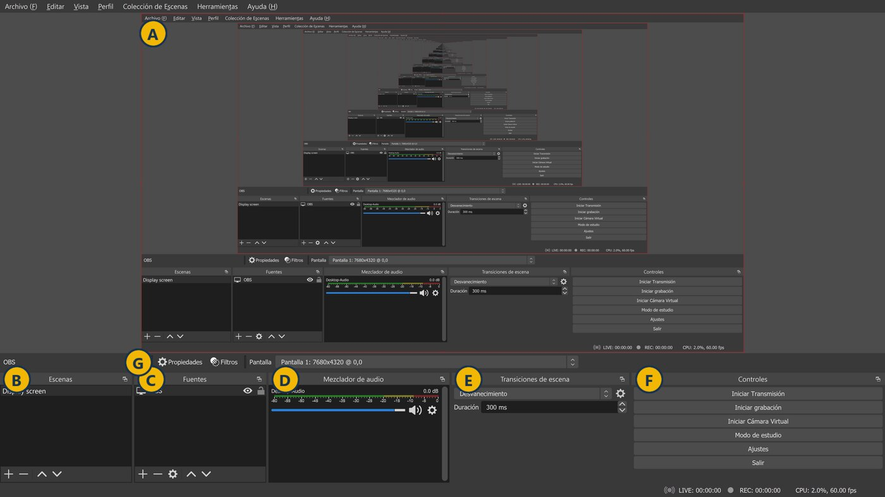
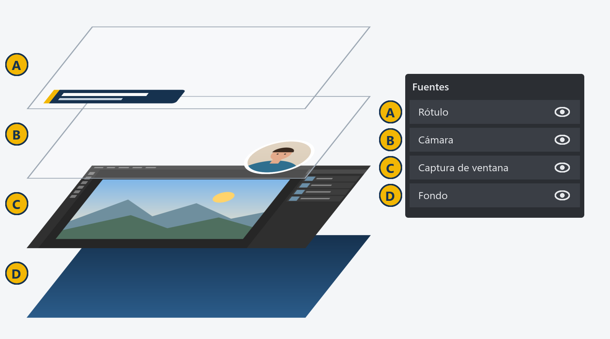
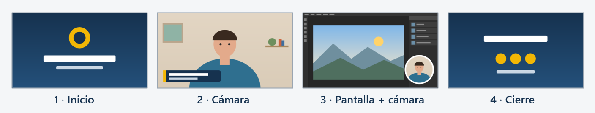
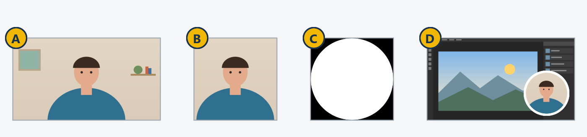
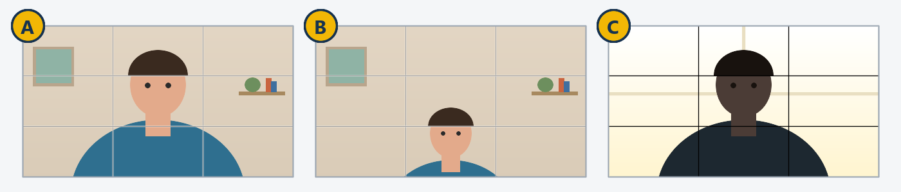
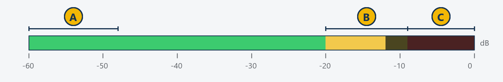

# Grabatu bideotutorial bat OBSrekin: eszenak eta iturriak

**OBS Studio** programa libre eta doakoa da, eta aldi berean grabatzen du zure pantailan, zure kameran eta zure mikrofonoan gertatzen dena. Praktika honetan lau eszena prestatuko dituzu eta haiekin minutu bat edo biko bideotutorial bat grabatuko duzu, **gero ezer editatu gabe**: grabatzen ari zaren bitartean eszenaz aldatzen duzu, eta bideoa muntatuta ateratzen da.

## Interfazea

*A. Aurrebista: hemen ikusten duzuna da grabatzen dena, zehatz-mehatz. B. Eszenak (`Escenas`). C. Hautatutako eszenaren iturriak (`Fuentes`). D. Audio-nahasgailua (`Mezclador de audio`). E. Eszena-trantsizioak (`Transiciones de escena`). F. Kontrolak (`Controles`): grabatu, ezarpenak eta irten. G. Hautatutako iturriaren barra, `Propiedades` eta `Filtros` botoiekin.*

- Aurrebistako "tunela" normala da: OBS bera dagoen pantaila kapturatzen ari da. Desagertu egiten da pantaila osoaren ordez leiho jakin bat kapturatzen duzunean.
- Panelen bat falta bazaizu, berreskuratu `Vista > Paneles` menuan.

## Eszenak eta iturriak

**Eszena** bat konposizio oso bat da: bideoaren une batean ikusten eta entzuten den guztia. **Iturri** bat eszenaren barruan dagoen gauza bakoitza da: pantaila, leiho bat, kamera, irudi bat, testu bat, atzeko planoko kolore bat.

*Iturriak Photoshopeko geruzak bezala pilatzen dira: zerrendan gorago dagoenak behekoak estaltzen ditu. A. Errotulua. B. Kamera. C. Leiho-kaptura. D. Atzeko planoa.*

Iturriak **Fuentes** paneleko `+` botoiarekin gehitzen dira. Erabiliko dituzunak:

| Iturria | Zertarako balio du |
|---|---|
| `Captura de ventana` | Leiho bakarra grabatzen du. Tutorial baterako aukerarik onena da: ez ditu jakinarazpenak erakusten, ezta mahaigainaren gainerakoa ere. |
| `Captura de pantalla` | Monitore oso bat grabatzen du. |
| `Dispositivo de captura de vídeo` | Webcama (edo webcam gisa erabilitako mugikorra). |
| `Imagen` | Atzeko plano bat, logo bat edo Photoshopen egindako errotulu bat. `.png` fitxategiek gardentasuna gordetzen dute. |
| `Texto (GDI+)` | OBSn bertan idatzitako tituluak eta errotuluak. |
| `Origen de color` | Kolore lauko atzeko plano bat. |

- **Mugitu eta eskalatu**: arrastatu iturria aurrebistan eta tira egin helduleku gorriei. `Ctrl+F` teklek pantailara doitzen dute. Gainerako aukerak eskuineko botoian daude, `Transformar` menuan.
- **Moztu**: `Alt` + helduleku bat arrastatu.
- **Begia eta giltzarrapoa** (iturri bakoitzaren eskuinean): begiak ezkutatu egiten du; giltzarrapoak blokeatu, nahi gabe ez mugitzeko.
- **Jarri izena guztiari**, geruzekin bezala: `Kamera`, `Photoshop leihoa`, `Izenaren errotulua`... Hilabete barru ez duzu jakingo zer den `Dispositivo de captura de vídeo 3`.
- Iturri bat hainbat eszenatan **berrerabil** daiteke: gehitzeko leihoan, aukeratu `Añadir existente`. Horrela kamera behin bakarrik konfiguratzen duzu.

## Grabatu aurretik: ezarpenak

Ireki `Ajustes` (**Controles** panela) eta berrikusi hiru fitxa:

- **Vídeo**: `Resolución base (lienzo)` eta `Resolución de salida (escalada)` `1920x1080` balioan, eta `Valores comunes de FPS` `30` balioan.
- **Salida**: `Ruta de grabación` atalean aukeratu erraz aurkituko duzun karpeta bat. `Formato de grabación` atalean aukeratu `MP4 híbrido`, zure bertsioak eskaintzen badu; bestela, utzi `mkv` eta, amaitzean, bihurtu `.mp4` formatura `Archivo > Convertir grabaciones` bidez. Arrazoia: OBS grabazioaren erdian ixten bada, `.mp4` arrunt bat erabilezin geratzen da, eta `.mkv` bat ez.
- **Audio**: egiaztatu `Audio Mic/Auxiliar` atalean zure mikrofonoa dagoela. Sistemaren soinuak grabatzea nahi ez baduzu, jarri `Audio de escritorio` `Desactivado` balioan.

## Lau eszenak

Sortu **Escenas** paneleko `+` botoiarekin, izen hauekin:

1. **Hasiera**: atzeko plano bat (`Origen de color` edo Photoshopen egindako 1920 × 1080ko `Imagen` bat) eta tutorialaren titulua `Texto (GDI+)` bidez.
2. **Kamera**: kamera pantaila osoan eta zure izena duen errotulu bat beheko herenean.
3. **Pantaila + kamera**: erakutsiko duzun programaren `Captura de ventana` bat, pantailara doituta, eta gainean kamera, txikia eta izkina batean.
4. **Itxiera**: hasierako atzeko plano bera eta azken ideia duen testu bat.

## Kamera biribila maskara batekin

*A. Kamera iristen den bezala, 16:9 formatuan. B. Karratu batera moztuta. C. Maskara: zirkulu zuri bat hondo beltzaren gainean. D. Emaitza leiho-kapturaren gainean.*

Photoshopeko geruza-maskarek bezala funtzionatzen du: maskararen zuria ikusi egiten da eta beltza ezkutatu.

1. **Pantaila + kamera** eszenan, egin eskuineko klik kameraren iturriaren gainean eta ireki `Filtros`.
2. **Filtros de efecto** atalean, sakatu `+` eta gehitu `Recortar/Rellenar`. Moztu berdin ezkerretik eta eskuinetik irudia karratu geratu arte: `420` eta `420` zure kamerak 1920 × 1080 ematen badu, edo `280` eta `280` 1280 × 720 ematen badu.
3. Sakatu `+` berriro eta gehitu `Máscara de imagen/mezcla`. `Tipo` atalean aukeratu `Máscara alfa (canal de color)` eta `Ruta` atalean bilatu materialeko `mascara-circulo.png` fitxategia.
4. Itxi leihoa, txikitu kamera eta kokatu ezer garrantzitsurik estaltzen ez duen izkina batean.

- Iragazkiak goitik behera aplikatzen dira: mozketak maskararen **gainean** egon behar du zerrendan.
- Zirkulu baten ordez obalo bat ateratzen bazaizu, mozketak ez du irudia karratu utzi.
- Hemen mozketa iragazkiarekin egiten da eta ez `Alt` + arrastatuz, beste mozketa hori maskararen ondoren aplikatzen delako eta zirkulua moztuko lukeelako.
- Materialean `mascara-esquinas-redondeadas.png` ere baduzu: kamera 16:9 formatuan uzten du, izkinak biribilduta. Horrekin ez dago moztu beharrik.

## Enkoadraketa eta argia

*A. Ondo: begiak goiko herenaren lerroan eta aire gutxi buruaren gainean. B. Gaizki: aire gehiegi goian, eta burua hondoratuta geratzen da. C. Gaizki: kontraargia. Leihoa atzean dagoenean, kamera leihoko argira egokitzen da eta aurpegia ilun geratzen da.*

- Argia, **zure aurrean**: jarri leiho bati edo flexo bati begira.
- Kamera, **begien parean**. Eramangarri bat erabiltzen baduzu, igo liburu batzuekin.
- Ikusten zaituenari hitz egiten diozunean, begiratu objektiboari, ez zure irudiari.
- Berrikusi zure atzean ageri dena.

## Soinua

*A. Baxuegi: gero igo egin beharko da, eta zarata ere igoko da. B. Eremu horia: hona iritsi behar dute zure ahotsaren gailurrek normal hitz egiten duzunean. C. Eremu gorria: soinua saturatu egiten da, eta horrek ez du konponbiderik.*

Irudi txarreko tutorial bat jasan daiteke; soinu txarrekoa, ez.

- Hitz egin grabazioan hitz egingo duzun bezala eta begiratu `Mic/Aux` kanalaren neurgailuari. Doitu irristailuarekin eta, batez ere, distantziarekin: mikrofonoa ahotik arra betera.
- `Mic/Aux` kanalaren hiru puntuetan ireki `Filtros` eta gehitu `Supresión de ruido`.
- Isildu mugikorra eta itxi soinuekin abisatzen duten aplikazioak.

## Eszenaz aldatu grabatzen ari zarela

- **Transiciones de escena** panelean utzi `Desvanecimiento`, `300 ms`-ko iraupenarekin.
- `Ajustes > Atajos` atalean esleitu tekla-konbinazio bat lau eszenetako bakoitzaren `Cambiar a escena` aukerari (adibidez, `Ctrl+Alt+1`etik `Ctrl+Alt+4`ra), eta beste bat `Iniciar grabación` eta `Detener grabación` aukerei. Horrela ez duzu OBSren leihora itzuli beharrik azaltzen ari zaren bitartean.

## Zer egin behar da

Grabatu **minutu bat edo biko bideotutorial bat**, ordenagailuarekin **gauza bakar bat** egiten irakasteko: aurreko praktiketako Photoshop teknika bat, Google Sheets-eko formula bat, Linuxeko komando bat, Windowseko ezarpen bat... Gutxi eta ondo azalduta.

1. Idatzi **gidoi** bat: 5-8 lerro, une bakoitzean zer esango duzun eta zer ikusiko den adierazteko.
2. Berrikusi bideoaren, irteeraren eta audioaren **ezarpenak**.
3. Sortu **lau eszenak**, iturri guztiak ondo izendatuta.
4. Jarri **kamera biribila** 3. eszenan.
5. Doitu **mikrofonoaren maila** eta gehitu zarata-murrizketa.
6. Konfiguratu eszenaz aldatzeko **lasterbideak**.
7. Grabatu **10 segundoko proba** bat, ikusi eta entzun entzungailuekin. Zuzendu huts egiten duena.
8. Grabatu tutoriala **hartualdi bakarrean**, lau eszenetatik ordenan pasatuz:
   - **Hasiera**: 2 edo 3 segundo.
   - **Kamera**: zure burua aurkeztu eta zer irakatsiko duzun esan, 10 edo 15 segundotan.
   - **Pantaila + kamera**: azalpena.
   - **Itxiera**: 3-5 segundo.

Okertzen bazara, errepikatu hartualdia. Praktika honetan ez da editatzen.

## Entrega

- Bideoa `.mp4` formatuan, 1920 × 1080 bereizmenean, minutu bat eta bi artekoa.
- Eszena-bilduma esportatuta: `Colección de escenas > Exportar` (`.json` fitxategi bat).
- OBSren pantaila-argazki bat, lau eszenak eta 3. eszenaren iturriak ikusten direla.
- Gidoia.

Praktika **GAI** izan dadin, hau guztia bete behar du:

- [ ] Lau eszenak badaude eta bideoan agertzen dira, ordenan.
- [ ] 3. eszenan programaren leihoa ikusten da (ez mahaigain osoa) eta kamera biribilak ez du ezer garrantzitsurik estaltzen.
- [ ] Ahotsa hasieratik amaierara ulertzen da, saturatu gabe eta hondoko zarata gogaikarririk gabe.
- [ ] Enkoadraketa zuzena da eta ez dago kontraargirik.
- [ ] Bideoak minutu bat eta bi artean irauten du eta `.mp4` formatuan dago, 1920 × 1080 bereizmenean.

## Irudien kredituak

- Interfazearen kaptura: [OBS Studio](https://obsproject.com/), GPL lizentziadun software librea.
- Eskemak praktika hauetarako sortu dira eta erabilera librekoak dira.
