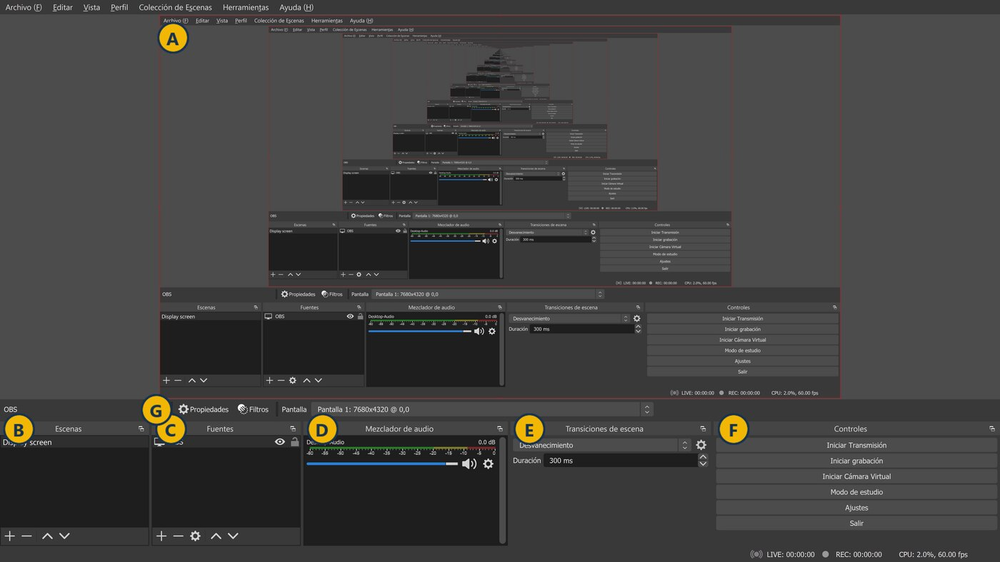
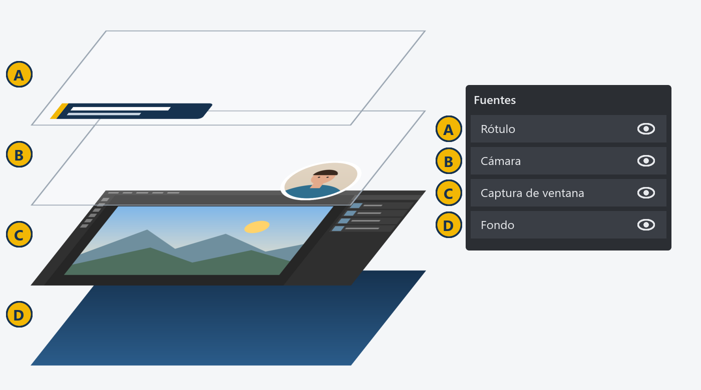
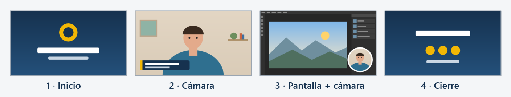
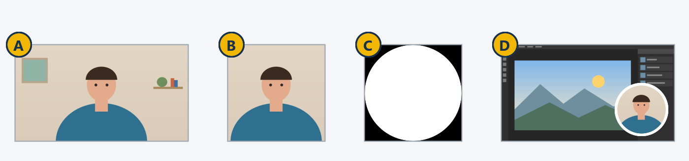
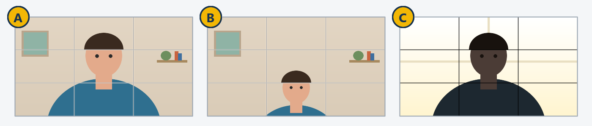
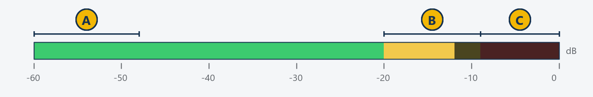

# Graba un videotutorial con OBS: escenas y fuentes

**OBS Studio** es un programa libre y gratuito que graba a la vez lo que pasa en tu pantalla, en tu cámara y en tu micrófono. En esta práctica vas a preparar cuatro escenas y a grabar con ellas un videotutorial de uno a dos minutos **sin editar nada después**: cambias de escena mientras grabas y el vídeo sale ya montado.

## La interfaz

*A. Vista previa: lo que ves aquí es exactamente lo que se graba. B. Escenas. C. Fuentes de la escena seleccionada. D. Mezclador de audio. E. Transiciones de escena. F. Controles: grabar, ajustes y salir. G. Barra de la fuente seleccionada, con `Propiedades` y `Filtros`.*

- El "túnel" de la vista previa es normal: OBS está capturando la pantalla en la que está él mismo. Desaparece cuando capturas una ventana concreta en lugar de la pantalla entera.
- Si te falta algún panel, recupéralo en `Vista > Paneles`.

## Escenas y fuentes

Una **escena** es una composición completa: todo lo que se ve y se oye en un momento del vídeo. Una **fuente** es cada una de las cosas que hay dentro de la escena: la pantalla, una ventana, la cámara, una imagen, un texto, un color de fondo.

*Las fuentes se apilan igual que las capas de Photoshop: la que está más arriba en la lista tapa a las de abajo. A. Rótulo. B. Cámara. C. Captura de ventana. D. Fondo.*

Las fuentes se añaden con el botón `+` del panel **Fuentes**. Las que vas a usar:

| Fuente | Para qué sirve |
|---|---|
| `Captura de ventana` | Graba una sola ventana. Es la mejor opción para un tutorial: no enseña las notificaciones ni el resto del escritorio. |
| `Captura de pantalla` | Graba un monitor entero. |
| `Dispositivo de captura de vídeo` | La webcam (o el móvil usado como webcam). |
| `Imagen` | Un fondo, un logo o un rótulo hecho en Photoshop. Los `.png` conservan la transparencia. |
| `Texto (GDI+)` | Títulos y rótulos escritos directamente en OBS. |
| `Origen de color` | Un fondo de color liso. |

- **Mover y escalar**: arrastra la fuente en la vista previa y tira de los tiradores rojos. `Ctrl+F` la ajusta a la pantalla. El resto de opciones están en el menú del botón derecho, en `Transformar`.
- **Recortar**: `Alt` + arrastrar un tirador.
- **Ojo y candado** (a la derecha de cada fuente): el ojo la oculta; el candado la bloquea para no moverla sin querer.
- **Pon nombre a todo**, igual que con las capas: `Cámara`, `Ventana Photoshop`, `Rótulo nombre`... Dentro de un mes no sabrás qué es `Dispositivo de captura de vídeo 3`.
- Una fuente se puede **reutilizar** en varias escenas: en el diálogo de añadir, elige `Añadir existente`. Así configuras la cámara una sola vez.

## Antes de grabar: los ajustes

Abre `Ajustes` (panel **Controles**) y revisa tres pestañas:

- **Vídeo**: `Resolución base (lienzo)` y `Resolución de salida (escalada)` en `1920x1080`, y `Valores comunes de FPS` en `30`.
- **Salida**: en `Ruta de grabación` elige una carpeta que sepas encontrar. En `Formato de grabación` elige `MP4 híbrido` si tu versión lo ofrece; si no, deja `mkv` y, al terminar, conviértelo a `.mp4` con `Archivo > Convertir grabaciones`. El motivo: si OBS se cierra a mitad de grabación, un `.mp4` normal queda inservible y un `.mkv` no.
- **Audio**: comprueba que en `Audio Mic/Auxiliar` está tu micrófono. Si no quieres que se graben los sonidos del sistema, pon `Audio de escritorio` en `Desactivado`.

## Las cuatro escenas

Créalas con el `+` del panel **Escenas**, con estos nombres:

1. **Inicio**: un fondo (`Origen de color` o una `Imagen` de 1920 × 1080 hecha en Photoshop) y el título del tutorial con `Texto (GDI+)`.
2. **Cámara**: la cámara a pantalla completa y un rótulo con tu nombre en el tercio inferior.
3. **Pantalla + cámara**: una `Captura de ventana` del programa que vas a enseñar, ajustada a la pantalla, y encima la cámara, pequeña y en una esquina.
4. **Cierre**: el mismo fondo del inicio y un texto con la idea final.

## Cámara circular con una máscara

*A. La cámara tal como llega, en 16:9. B. Recortada a un cuadrado. C. La máscara: un círculo blanco sobre fondo negro. D. El resultado sobre la captura de ventana.*

Funciona como las máscaras de capa de Photoshop: lo blanco de la máscara se ve y lo negro se oculta.

1. En la escena **Pantalla + cámara**, haz clic derecho sobre la fuente de la cámara y abre `Filtros`.
2. En **Filtros de efecto**, pulsa `+` y añade `Recortar/Rellenar`. Recorta lo mismo por la izquierda y por la derecha hasta dejar la imagen cuadrada: `420` y `420` si tu cámara da 1920 × 1080, o `280` y `280` si da 1280 × 720.
3. Pulsa `+` otra vez y añade `Máscara de imagen/mezcla`. En `Tipo` elige `Máscara alfa (canal de color)` y en `Ruta` busca el archivo `mascara-circulo.png` del material.
4. Cierra la ventana, reduce la cámara y colócala en una esquina donde no tape nada importante.

- Los filtros se aplican de arriba abajo: el recorte tiene que estar **encima** de la máscara en la lista.
- Si te sale un óvalo en lugar de un círculo, el recorte no ha dejado la imagen cuadrada.
- Aquí el recorte se hace con el filtro y no con `Alt` + arrastrar, porque ese otro recorte se aplica después de la máscara y cortaría el círculo.
- En el material tienes también `mascara-esquinas-redondeadas.png`, que deja la cámara en 16:9 con las esquinas redondeadas. Con ella no hace falta recortar.

## Encuadre y luz

*A. Bien: los ojos sobre la línea del tercio superior y poco aire por encima de la cabeza. B. Mal: sobra aire arriba y la cabeza queda hundida. C. Mal: contraluz. Con la ventana detrás, la cámara se ajusta a la luz de la ventana y la cara queda a oscuras.*

- La luz, **delante de ti**: ponte de cara a una ventana o a un flexo.
- La cámara, **a la altura de los ojos**. Si usas un portátil, súbelo con unos libros.
- Mira al objetivo cuando hables a quien te ve, no a tu propia imagen.
- Revisa lo que sale detrás de ti.

## Sonido

*A. Demasiado bajo: después habrá que subirlo y subirá también el ruido. B. Zona amarilla: aquí tienen que llegar los picos de tu voz cuando hablas normal. C. Zona roja: el sonido satura, y eso ya no tiene arreglo.*

Un tutorial con mala imagen se aguanta; con mal sonido, no.

- Habla como vas a hablar en la grabación y mira el vúmetro de `Mic/Aux`. Ajusta con el deslizador y, sobre todo, con la distancia: el micrófono a un palmo de la boca.
- En los tres puntos del canal `Mic/Aux` abre `Filtros` y añade `Supresión de ruido`.
- Silencia el móvil y cierra las aplicaciones que avisan con sonidos.

## Cambiar de escena mientras grabas

- En **Transiciones de escena** deja `Desvanecimiento` con una duración de `300 ms`.
- En `Ajustes > Atajos` asigna una combinación de teclas a `Cambiar a escena` en cada una de las cuatro escenas (por ejemplo, `Ctrl+Alt+1` a `Ctrl+Alt+4`) y otra a `Iniciar grabación` y `Detener grabación`. Así no tienes que volver a la ventana de OBS mientras explicas.

## Qué hay que hacer

Graba un **videotutorial de 1 a 2 minutos** en el que enseñes a hacer **una sola cosa** con el ordenador: una técnica de Photoshop de las prácticas anteriores, una fórmula de Google Sheets, un comando de Linux, un ajuste de Windows... Poco y bien explicado.

1. Escribe un **guion**: de 5 a 8 líneas con lo que vas a decir y lo que se va a ver en cada momento.
2. Revisa los **ajustes** de vídeo, salida y audio.
3. Crea las **cuatro escenas**, con todas las fuentes bien nombradas.
4. Pon la **cámara circular** en la escena 3.
5. Ajusta el **nivel del micrófono** y añade la supresión de ruido.
6. Configura los **atajos** para cambiar de escena.
7. Graba una **prueba de 10 segundos**, mírala y escúchala con auriculares. Corrige lo que falle.
8. Graba el tutorial **en una sola toma**, pasando por las cuatro escenas en orden:
   - **Inicio**: 2 o 3 segundos.
   - **Cámara**: te presentas y dices qué vas a enseñar, en 10 o 15 segundos.
   - **Pantalla + cámara**: la explicación.
   - **Cierre**: 3 a 5 segundos.

Si te equivocas, repite la toma. En esta práctica no se edita.

## Entrega

- El vídeo en `.mp4`, a 1920 × 1080, de 1 a 2 minutos.
- La colección de escenas exportada: `Colección de escenas > Exportar` (un archivo `.json`).
- Una captura de pantalla de OBS en la que se vean las cuatro escenas y las fuentes de la escena 3.
- El guion.

Para que la práctica sea **APTO** tiene que cumplir todo esto:

- [ ] Las cuatro escenas existen y aparecen en el vídeo, en orden.
- [ ] En la escena 3 se ve la ventana del programa (no el escritorio entero) y la cámara circular no tapa nada importante.
- [ ] La voz se entiende de principio a fin, sin saturar y sin ruido de fondo molesto.
- [ ] El encuadre es correcto y no hay contraluz.
- [ ] El vídeo dura entre 1 y 2 minutos y está en `.mp4` a 1920 × 1080.

## Créditos de las imágenes

- Captura de la interfaz: [OBS Studio](https://obsproject.com/es), software libre con licencia GPL.
- Los esquemas se han generado para estas prácticas y son de uso libre.
