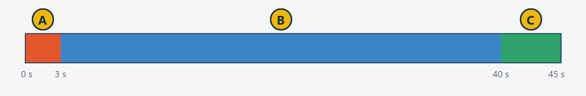

# Azken proiektua: bideo labur bat hasieratik amaierara

Aurreko guztia batera, eta oraingoan hutsetik: ideia, gidoia, grabazioa, muntaketa eta entrega. Enkargua **45-60 segundoko bideo bertikal bat** da, ikastetxearen edo enpresa baten sare sozialetan argitaratzeko pentsatua.

Aukeratu hiru enkargu hauetako **bat**:

1. **Tutorial teknikoa.** Irakatsi zikloari dagokion zerbait egiten, aurreko praktiketako tutorialaz bestelakoa: disko bat klonatu, IP finko bat konfiguratu, roseta bat muntatu, Linuxen erabiltzaile bat sortu...
2. **Zerbitzu baten aurkezpena.** ETE erronkako zuen enpresak zerbitzu bat eskaintzen du (mantentze-lanak, sareen instalazioa, segurtasun-kopiak...). Kontatu zer den, norentzat den eta zergatik aukeratu behar zaituzteten.
3. **Zikloaren sustapena.** Ate irekien jardunaldirako bideo bat, DBHko 4. mailako norbaiti azaltzeko zer egiten den Mikroinformatika Sistemak eta Sareak zikloan.

## Baldintzak

*A. Amua: lehen 3 segundoak. B. Garapena. C. Itxiera: azken 5 segundoak.*

- **Formatua**: bertikala, 1080 × 1920, `.mp4` (H.264), 30 fps.
- **Iraupena**: 45 eta 60 segundo artean.
- **Egitura**: amua, garapena eta itxiera.
- **Irudia**: gutxienez **bi plano mota** hiru hauetatik: kamera frontala, kamera zenitala eta OBSrekin grabatutako pantaila-kaptura.
- **Testuak**: testu bat ideia bakoitzeko, eremu seguruen barruan. Bideoak soinurik gabe ulertu behar du.
- **Soinua**: ahots argia eta maila konstantean. Musikarik badago, ahotsaren azpitik eta lizentziarekin.
- **Azala**: Photoshopen egindako 1080 × 1920ko irudi bat, bideoaren izenburuarekin. Profilean ikusiko litzatekeena da, bideoa erreproduzitu aurretik.
- **Taldea**: taldekide guztiek parte hartzen dute, eta kredituek esaten dute nork zer egin duen (gidoia, kamera, ahotsa, muntaketa, azala).

> [!WARNING]
> Pantaila-kaptura bat horizontala da eta bideoa bertikala. Ez txikitu irakurri ezin den arte: handitu interesatzen den eremua edo zatitu pantaila, kaptura goian eta kamera edo testua behean jarrita.

## Faseak

### 1. Ideia eta gidoia

- Idatzi helburua esaldi batean: "Bideo hau ikusi ondoren, ikusten duenak jakingo du...".
- Erabaki nori zuzenduta dagoen. Bezero bati ez zaio DBHko ikasle bati bezala hitz egiten.
- Idatzi gidoia bi zutabeko taula batean, bloke bakoitzaren denborarekin:

| Denbora | Ikusten da | Entzuten da |
|---|---|---|
| 0–3 s | Zenitala: kable amaitua, egiaztagailuaren LEDa pizten. | "Zure sare-kablea, 40 segundotan." |
| 3–10 s | Zenitala: zorroa zuritzen da. Testua: "1. Zuritu 3 cm". | "Zuritu hiru zentimetro zorro, hariak ukitu gabe." |
| ... | ... | ... |

Irakurri gidoia ozen kronometro batekin. Abiadura normalean minutuko **100-120 hitz** inguru esaten dira: gidoiak gehiago baditu, ez da sartzen.

### 2. Storyboarda

Pasatu gidoia materialeko storyboard-txantiloira: bineta bat plano bakoitzeko, plano motarekin, pantailako testuarekin, ahotsarekin eta iraupenarekin.

### 3. Grabazioa

Berrikusi grabatu aurretik:

- [ ] Kamerak, 1080p eta 30 fps-tan, fokua eta esposizioa blokeatuta.
- [ ] Argia, aurrean edo alboan. Kontraargirik gabe eta erakusten denaren gainean itzalik gabe.
- [ ] Mikrofonoa, ahotik gertu. 10 segundoko proba, entzungailuekin entzunda.
- [ ] Txaloa hartualdi bakoitzaren hasieran, bi kamera badaude.
- [ ] Mugikorrak hegaldi moduan.

### 4. Muntaketa

CapCutekin, aurreko praktikan bezala: sinkronizatu, isiluneak kendu, ordenatu, testuak, soinua eta esportatu. **Pro** elementurik gabe.

### 5. Berrikuspena

Entregatu aurretik, erakutsi bideoa **beste talde bati**, ezer azaldu gabe, eta galdetu:

- Zer ulertu duzue bideoak azaltzen duela?
- Zein unetan galdu edo aspertu zarete?
- Ba al zegoen irakurtzeko astirik ematen ez zuen testurik?

Apuntatu esaten dizuetena eta aldatu gutxienez **bi gauza** haien erantzunetatik abiatuta.

### 6. Aurkezpena

Bideoak klasean ikusiko dira. Talde bakoitzak minutu batean kontatuko du zein enkargu aukeratu zuen, zer aldatu zuen berrikuspenaren ondoren eta zer egingo lukeen desberdin hurrengoan.

## Entrega

- `gidoia-eta-storyboarda.pdf`: helburua, bi zutabeko gidoia eta storyboarda.
- `azken-bideoa.mp4`.
- `azala.jpg`, 1080 × 1920koa.
- CapCuten pantaila-argazki bat, denbora-lerro osoarekin.
- `kredituak.txt`: nork zer egin duen, musika eta besteren baliabideak (izenburua, egilea, lizentzia eta esteka) eta berrikuspenaren ondoren egin zenituzten bi aldaketak.

Bideoa Moodlen entregatzen da: **ez dago inongo saretan argitaratu beharrik**. Taldekoa ez den norbait agertzen bada, eskatu baimena grabatu aurretik.

Entregatu aurretik:

- [ ] 45 eta 60 segundo artean irauten du.
- [ ] Bertikala da, 1080 × 1920, `.mp4` formatuan.
- [ ] Eremu seguruen gida ez da esportatutako bideoan agertzen.
- [ ] Soinurik gabe ulertzen da.
- [ ] Ahotsak ez du saturatzen eta musikak ez du estaltzen.
- [ ] Testuetan ez dago ortografia-akatsik.
- [ ] Fitxategiek eskatutako izenak dituzte.

## Kalifikazioa (0tik 10era)

| Irizpidea | Puntuak | Zer baloratzen da |
|---|:---:|---|
| Plangintza | 1,5 | Helburu argia; gidoia eta storyboarda bat datoz azken bideoarekin. |
| Irudia | 2 | Enkoadraketa, argia, egonkortasuna eta fokua; bi plano mota ondo konbinatuta. |
| Soinua | 1,5 | Ahots argia eta konstantea, saturatu gabe; musika azpitik eta lizentziarekin. |
| Muntaketa | 2 | Amua, denbora hilik gabeko erritmoa eta itxiera; mozketa garbiak; kamerak sinkronizatuta. |
| Testuak eta formatu bertikala | 1,5 | Irakurgarriak, akatsik gabeak eta eremu seguruen barruan; soinurik gabe ulertzen da. |
| Entrega eta berrikuspena | 1,5 | Formatu eta iraupen zuzenak, azala, kredituak, berrikuspenaren ondorengo aldaketak eta aurkezpena. |

5ekoarekin gainditzen da.

## Irudien kredituak

- Eskemak praktika hauetarako sortu dira eta erabilera librekoak dira.
