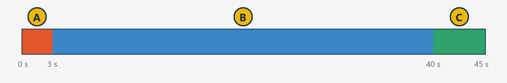

# Proyecto final: un vídeo corto de principio a fin

Todo lo anterior junto, y esta vez desde cero: idea, guion, grabación, montaje y entrega. El encargo es **un vídeo vertical de 45 a 60 segundos** pensado para publicarse en las redes sociales del centro o de una empresa.

Elegid **uno** de estos tres encargos:

1. **Tutorial técnico.** Enseñad a hacer algo propio del ciclo, distinto del tutorial de las prácticas anteriores: clonar un disco, configurar una IP fija, montar una roseta, crear un usuario en Linux...
2. **Presentación de un servicio.** Vuestra empresa del reto PYME ofrece un servicio (mantenimiento, instalación de redes, copias de seguridad...). Contad qué es, para quién es y por qué elegiros.
3. **Promoción del ciclo.** Un vídeo para la jornada de puertas abiertas que explique a alguien de 4.º de ESO qué se hace en Sistemas Microinformáticos y Redes.

## Requisitos

*A. Gancho: los 3 primeros segundos. B. Desarrollo. C. Cierre: los últimos 5 segundos.*

- **Formato**: vertical, 1080 × 1920, `.mp4` (H.264) a 30 fps.
- **Duración**: entre 45 y 60 segundos.
- **Estructura**: gancho, desarrollo y cierre.
- **Imagen**: al menos **dos tipos de plano** de estos tres: cámara frontal, cámara cenital y captura de pantalla grabada con OBS.
- **Textos**: un texto por idea, dentro de las zonas seguras. El vídeo tiene que entenderse sin sonido.
- **Sonido**: voz clara y a un nivel constante. Si hay música, por debajo de la voz y con licencia.
- **Portada**: una imagen de 1080 × 1920 hecha en Photoshop, con el título del vídeo. Es lo que se vería en el perfil antes de reproducirlo.
- **Equipo**: todos los miembros del grupo participan, y los créditos dicen quién ha hecho qué (guion, cámara, voz, montaje, portada).

> [!WARNING]
> Una captura de pantalla es horizontal y el vídeo es vertical. No la encojáis hasta que no se lea: ampliad la zona que interesa o partid la pantalla, con la captura arriba y la cámara o el texto abajo.

## Fases

### 1. Idea y guion

- Escribid el objetivo en una frase: "Después de ver este vídeo, quien lo vea sabrá...".
- Decidid a quién va dirigido. No se le habla igual a un cliente que a un alumno de la ESO.
- Escribid el guion en una tabla de dos columnas, con el tiempo de cada bloque:

| Tiempo | Se ve | Se oye |
|---|---|---|
| 0–3 s | Cenital: el cable terminado encendiendo el LED del comprobador. | "Tu cable de red, en 40 segundos." |
| 3–10 s | Cenital: se pela la funda. Texto: "1. Pela 3 cm". | "Pela tres centímetros de funda sin tocar los hilos." |
| ... | ... | ... |

Leed el guion en voz alta con un cronómetro. A velocidad normal se dicen unas **130 palabras por minuto**: si el guion tiene más, no cabe.

### 2. Storyboard

Pasad el guion a la plantilla de storyboard del material: una viñeta por plano, con el tipo de plano, el texto en pantalla, la voz y la duración.

### 3. Grabación

Repasad antes de grabar:

- [ ] Las cámaras, a 1080p y 30 fps, con el enfoque y la exposición bloqueados.
- [ ] La luz, delante o de lado. Sin contraluz y sin sombras sobre lo que se enseña.
- [ ] El micrófono, cerca de la boca. Prueba de 10 segundos escuchada con auriculares.
- [ ] Palmada al empezar cada toma si hay dos cámaras.
- [ ] Móviles en modo avión.

### 4. Montaje

Con CapCut, como en la práctica anterior: sincronizar, quitar silencios, ordenar, textos, sonido y exportar. Sin elementos **Pro**.

### 5. Revisión

Antes de entregar, enseñad el vídeo **a otro grupo**, sin explicarles nada, y preguntadles:

- ¿Qué habéis entendido que explica el vídeo?
- ¿En qué momento os habéis perdido o aburrido?
- ¿Había algún texto que no diera tiempo a leer?

Apuntad lo que os digan y cambiad al menos **dos cosas** a partir de sus respuestas.

### 6. Presentación

Los vídeos se verán en clase. Cada grupo contará en un minuto qué encargo eligió, qué cambió después de la revisión y qué haría distinto la próxima vez.

## Entrega

- `guion-y-storyboard.pdf`: el objetivo, el guion a dos columnas y el storyboard.
- `video-final.mp4`.
- `portada.jpg`, de 1080 × 1920.
- Una captura de pantalla de CapCut con la línea de tiempo completa.
- `creditos.txt`: quién ha hecho qué, la música y los recursos ajenos (título, autor, licencia y enlace) y los dos cambios que hicisteis después de la revisión.

El vídeo se entrega en Moodle: **no hay que publicarlo** en ninguna red. Si aparece alguien que no es del grupo, pedidle permiso antes de grabar.

Antes de entregar:

- [ ] Dura entre 45 y 60 segundos.
- [ ] Es vertical, 1080 × 1920, en `.mp4`.
- [ ] La guía de zonas seguras no aparece en el vídeo exportado.
- [ ] Se entiende sin sonido.
- [ ] La voz no satura y la música no la tapa.
- [ ] No hay faltas de ortografía en los textos.
- [ ] Los archivos se llaman como se pide.

## Calificación (0 a 10)

| Criterio | Puntos | Qué se valora |
|---|:---:|---|
| Planificación | 1,5 | Objetivo claro; el guion y el storyboard se corresponden con el vídeo final. |
| Imagen | 2 | Encuadre, luz, estabilidad y enfoque; dos tipos de plano bien combinados. |
| Sonido | 1,5 | Voz clara y constante, sin saturar; música por debajo y con licencia. |
| Montaje | 2 | Gancho, ritmo sin tiempos muertos y cierre; cortes limpios; cámaras sincronizadas. |
| Textos y formato vertical | 1,5 | Legibles, sin faltas y dentro de las zonas seguras; se entiende sin sonido. |
| Entrega y revisión | 1,5 | Formato y duración correctos, portada, créditos, cambios tras la revisión y presentación. |

Se aprueba con un 5.

## Créditos de las imágenes

- Los esquemas se han generado para estas prácticas y son de uso libre.
